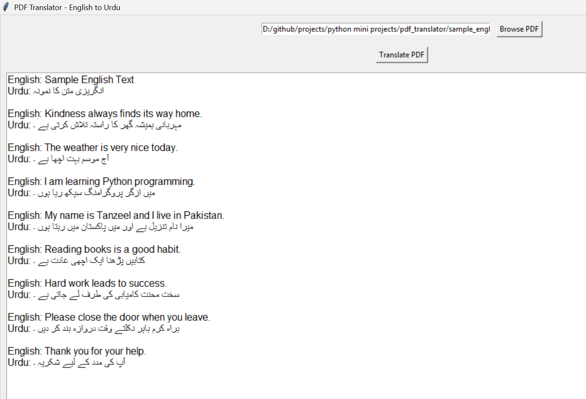

# PDF Translator (English to Urdu)

A simple desktop app that reads a PDF and translates it line by line into Urdu.

## Setup
1. Install Python from https://www.python.org/downloads/
2. Install libraries:
   pip install -r requirements.txt
3. Run:
   python pdf_translator.py

## Notes
- Internet connection required.
- Uses the free MyMemory translation API (daily free limit applies;
  you can add your email in the code to raise it).
- Scanned/image-only PDFs are not supported (no OCR).
- Windows: Tkinter is included with Python. Linux: sudo apt install python3-tk
